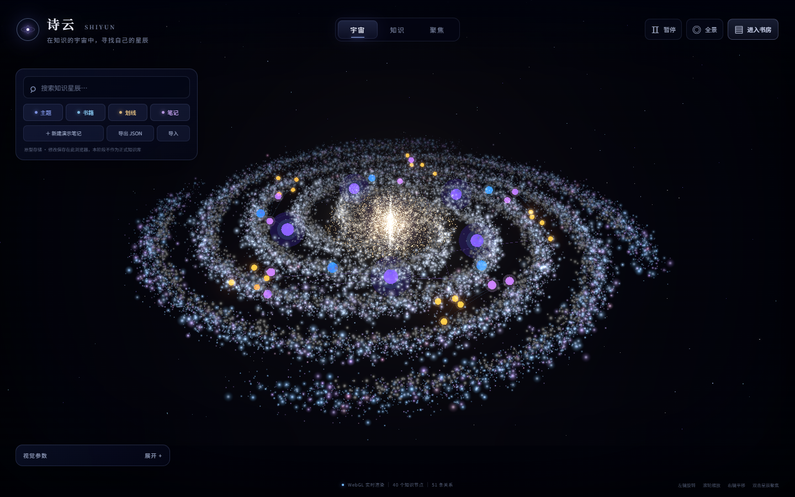
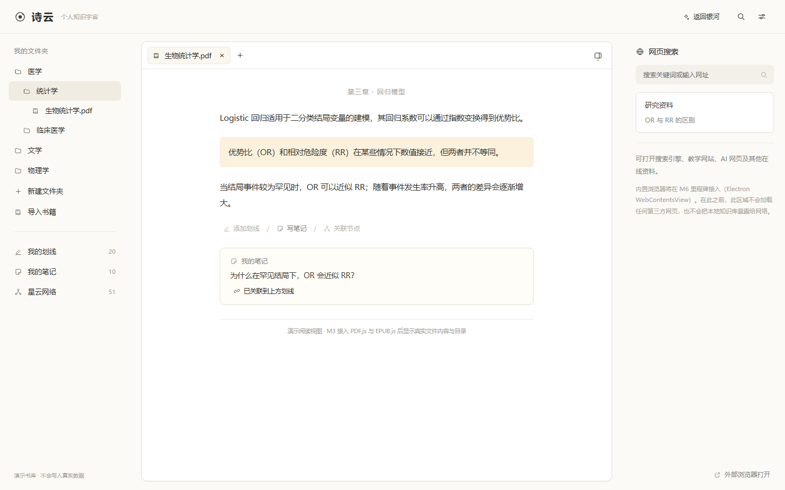
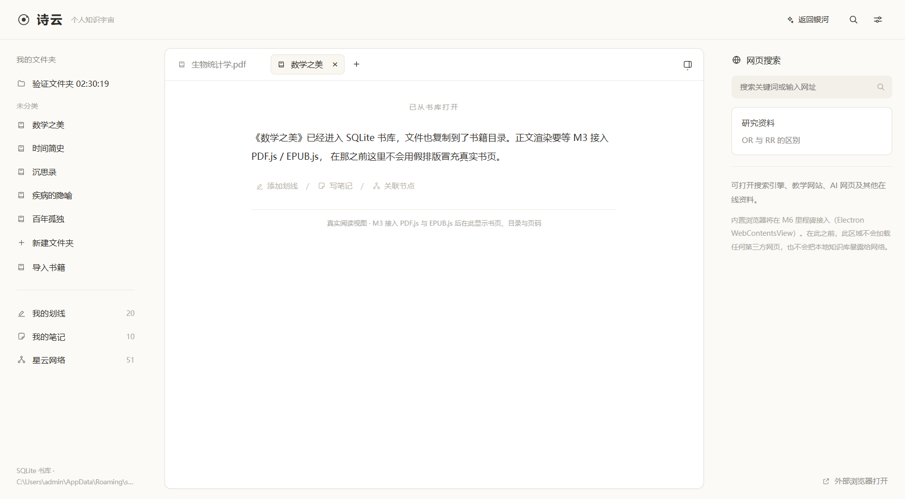
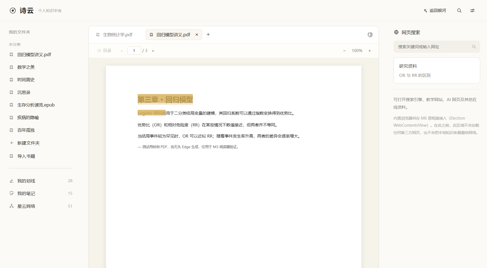
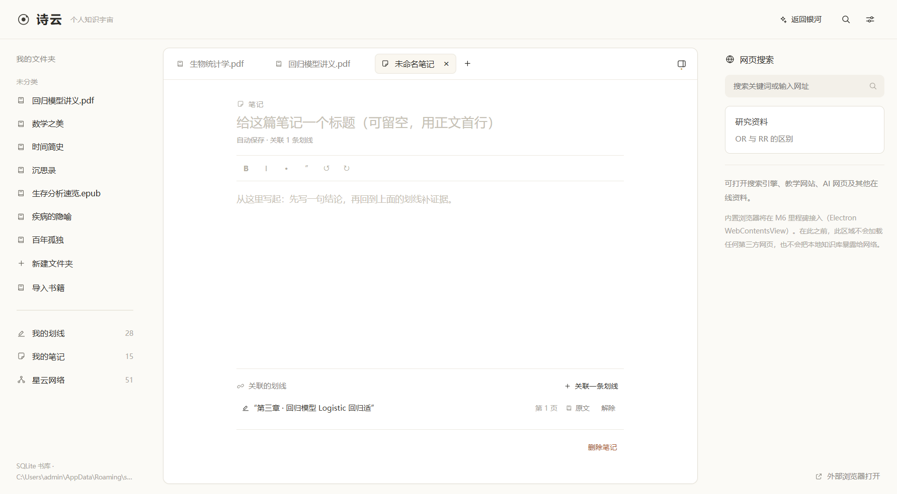
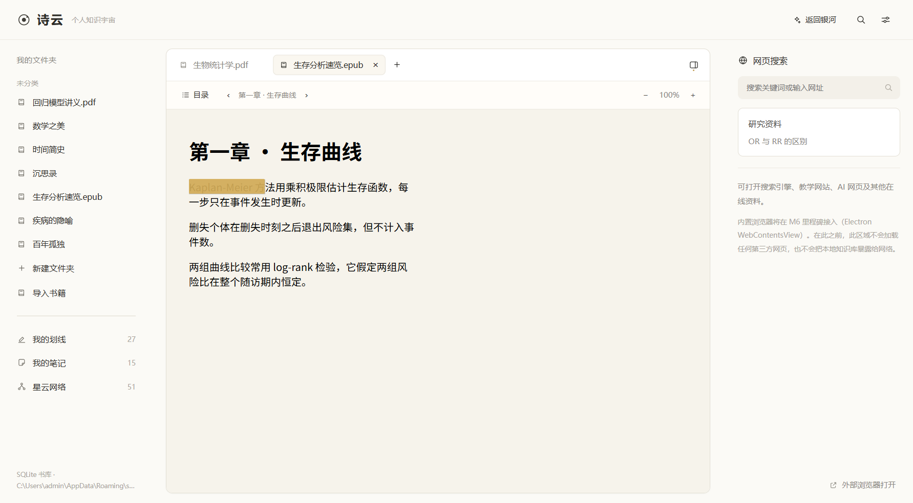
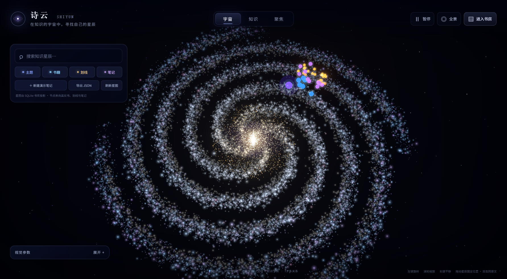
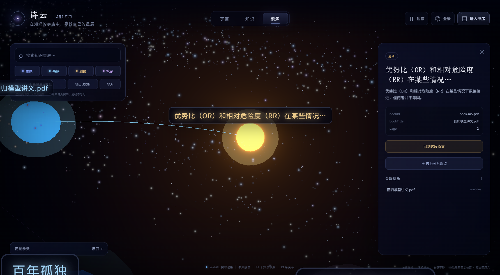
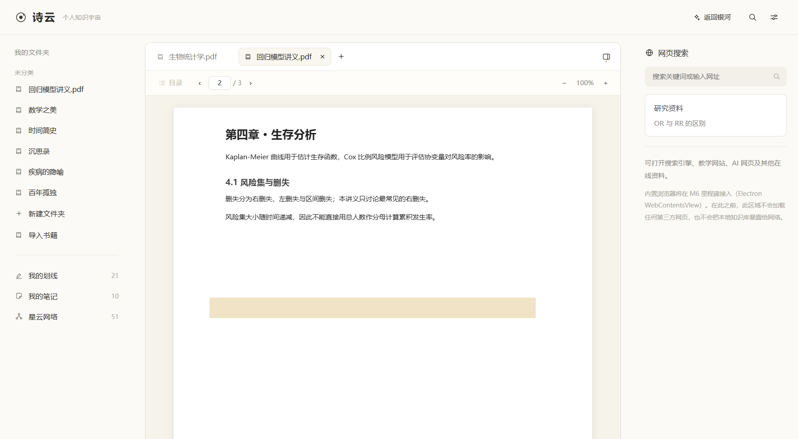
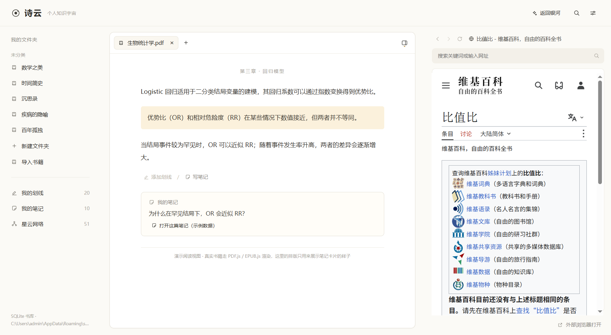

# 诗云 SHIYUN

> 在知识的宇宙中，寻找自己的星辰。

诗云是一个本地优先的个人知识管理桌面软件（Windows 优先）。它由两个共用同一份知识数据的空间组成：

- **银河大厅**：深色三维螺旋银河，承载书籍、划线、笔记、主题与知识关系。银河粒子只是氛围，与知识对象完全分离。
- **学习书房**：浅色三栏阅读工作台（文件树 / 多标签阅读与笔记 / 网页研究栏），用于真正读书、划线、写笔记与查资料。






















> 第三张是 Electron 45 里的真实书库：目录来自 `%APPDATA%\shiyun\shiyun.db`；第四、五张是同一个数据库里的真实 PDF 与 EPUB 在阅读器里渲染的样子（PDF.js 画布 + 页码/缩放，EPUB.js 分页 + 目录 + 字号）；第六张是选中正文划出的金色划线，第七张是划线带出来的三栏式笔记编辑器（标题可留空，正文自动保存，下方列出关联划线），第八张是关掉 EPUB 再重新打开后，靠 CFI 复原的划线；第九张是同一份书库投影出来的星图（状态条写明「书库投影 38 个知识节点 73 条关系」），第十张是点中一颗划线星后的检查面板（`page 2` 与「回到这段原文」），第十一张是从银河双击那颗星回到书里第 2 页、划线仍在原位，第十二张是右栏内嵌的**真实网页**（主进程 `WebContentsView`，地址栏、前进后退、刷新都可用）。
>
> 第十二张说明：`WebContentsView` 是原生视图，不进入 DOM，所以那张图把该视图自己的截图贴回了它所在的矩形；除此之外整张图就是应用截图。

## 当前进度

| 里程碑 | 内容 | 状态 |
| --- | --- | --- |
| M0 | 接管现有原型、基线验证、标签 `galaxy-baseline` | 完成 |
| M1 | Electron 外壳 + 银河/书房双空间导航 + 书房三栏骨架 | 完成（桌面窗口已实机验证） |
| M2 | SQLite 书库、真实文件夹树、导入 PDF/EPUB | 完成（桌面实机验证） |
| M3 | PDF.js / EPUB.js 阅读器（目录、翻页、缩放、阅读进度） | 完成（桌面实机验证） |
| M4 | 划线、笔记、多对多关联 | 完成（桌面实机验证） |
| M5 | 真实知识库生成星图（GraphDataAdapter） | 完成（桌面实机验证） |
| M6 | 右侧真实内嵌浏览器（WebContentsView） | 完成（桌面实机验证） |
| M7 | 打磨、Windows 打包、自动更新 | 完成安装包与打包流程（未签名、无自动更新） |
| 阶段一 | 浏览器标签持久化 + 网页摘录（WebClipping）+ TranslationProvider | 完成（桌面实机 + `scripts/e2e/research.mjs` 通过） |

细节见 [DEVELOPMENT_PLAN.md](./DEVELOPMENT_PLAN.md)。任何"未实现"的界面元素都在 UI 中显式标注「开发中 / Mx 接入」，不使用静态假功能冒充已完成功能。

## 运行

需要 Node.js 20 或更高版本。

```bash
npm install
```

**浏览器模式**（无需 Electron 二进制，适合快速看界面）：

```bash
npm run dev:web
# http://localhost:5173          银河大厅
# http://localhost:5173/?space=workspace  直接打开学习书房
```

`?space=workspace` 只是开发与验收用的深链，正式入口是银河右上角的「进入书房」按钮和书房顶部的「返回银河」。

**桌面模式**（Electron）：

```bash
npm run dev
```

> `npm install` 会在 `postinstall` 阶段下载 Electron 二进制（约 150 MB）。如果网络无法访问 GitHub Releases，`node_modules/electron/dist` 会是空的，`npm run dev` 会报错而 `npm run dev:web` 仍可用。可设置镜像后重装：`ELECTRON_MIRROR=https://npmmirror.com/mirrors/electron/ npm install`。也可以用 `https://cdn.npmmirror.com/binaries/electron/<version>/` 直接下载 zip、校验 `SHASUMS256.txt` 后解压到 `node_modules/electron/dist`（详见 [AGENTS.md](./AGENTS.md) §7）。
>
> 若终端里有 `ELECTRON_RUN_AS_NODE=1`（某些 Electron 宿主的子进程会继承），启动前需要清掉，否则窗口不会出现。

**打包成 Windows 安装包**：

```bash
npm run dist          # 出 release/Shiyun-<version>-win-x64.exe（NSIS 安装器）
npm run pack          # 只出 release/win-unpacked/ 免安装目录，便于快速验证
npm run dist:offline  # 同上，但用已装好的 node_modules/electron/dist 打包（GitHub 不可达时用这个）
```

> 安装包约 160 MB（Electron 本体占绝大部分），`release/` 不进版本库。安装器**没有代码签名**，第一次运行会被 Windows SmartScreen 拦一下（「更多信息 → 仍要运行」）。安装与升级都**不会**动 `%APPDATA%\shiyun`，卸载也不删书库——升级前建议整目录备份一份。

**校验命令**：

```bash
npm run typecheck   # tsc -b
npm run lint        # oxlint
npm run test        # vitest run
npm run build       # 类型检查 + electron-vite 构建
npm run build:web   # 纯网页构建
```

## 已实现

### 打包与运行状态（M7）

- `electron-builder` + NSIS 安装器：`release/Shiyun-0.1.0-win-x64.exe`（164 MB）、`latest.yml`、`blockmap` 一并产出；`release/` 已被 `.gitignore` 忽略。
- 应用图标 `build/icon.ico`（7 个尺寸，由 `scripts/build-icon.mjs` 从 `build/icon-*.png` 打包；PNG 由 System.Drawing 画出，不引图像依赖）。缺了它 `electron-builder` 会用 Electron 默认图标。
- **数据目录钉死为 `%APPDATA%\shiyun`**：打包后 `app.getName()` 会变成「诗云」，若跟随默认值会换一个 userData 目录，用户的书看起来像"丢了"。主进程在 `whenReady` 之前 `app.setPath('userData', join(app.getPath('appData'), 'shiyun'))`。
- 崩溃与日志：`electron/main/logging.ts` 把主进程未捕获异常写进 `%APPDATA%\shiyun\logs\main-YYYY-MM-DD.log` 并弹一次可读的错误框；渲染进程 `render-process-gone` / `unresponsive` 也记一行。静默崩溃是最难查的 bug，这里宁可多一条日志。
- 键盘：书房内 `Ctrl/Cmd+O` 导入书籍、`Ctrl/Cmd+B` 开关右栏；标签用 `role="tab"` + `aria-selected`，全局 `:focus-visible` 有可见焦点环。
- 安装包实机验证：`release/win-unpacked/诗云.exe` 启动后 `window.shiyunDesktop` 六个能力齐全（`getRuntimeInfo`/`openExternal`/`library`/`annotations`/`graph`/`research`），`library.getMeta()` 指向 `C:\Users\admin\AppData\Roaming\shiyun`，`listTree()` 读到已有的 5 本书 / 20 条划线 / 10 篇笔记，`pdfjs/cmaps` 资源返回 200，星图照常投影出 36 节点 / 71 关系。

### 银河大厅（M0 基线，保留原始实现）

- 稳定随机种子的三维螺旋银河：3–5 条旋臂、1–4 万批量粒子、星核、暗尘带、远景星场、受控 Bloom。
- 左键旋转、滚轮缩放、右键平移、阻尼、暂停、平滑聚焦、回到全景。
- 宇宙 / 知识 / 聚焦三种模式；节点悬停、单击、双击飞行、搜索、类型筛选、邻接高亮。
- 节点信息卡、关联对象、关系详情；新建演示笔记、连接两个节点成关系、删除关系但保留实体。
- 默认 / 高画质 / 低性能预设与实时视觉参数面板。
- 装饰层（`components/galaxy`）与知识层（`components/knowledge`）分离，共享相机坐标但不共享数据身份。

### 学习书房（M1）

- 与银河公用同一份 `KnowledgeGraphData`：左栏「我的划线 / 我的笔记 / 星云网络」计数、顶部全局搜索都读取真实图谱。
- 顶部导航：诗云标识、个人知识宇宙、全局搜索（回车或输入即搜，命中后跳回银河并聚焦该节点）、布局设置（重置栏宽、显示/隐藏研究栏）、「返回银河」。
- 左栏文件树：目录来自真实书库（见下节），支持展开/折叠、选中态、双击打开标签页；底部「我的划线 / 我的笔记」是真实列表入口。
- 中栏多标签阅读：可关闭标签、空状态、书页视图（真实 PDF/EPUB；内置演示书才有排版样例，并明确标注是演示）、笔记页（TipTap 编辑器）、划线列表页、笔记列表页。
- 右栏网页研究栏：桌面版是真实内嵌网页，支持地址/搜索、多标签、关闭、历史、缩放和外部打开；纯浏览器预览不伪装内嵌能力，只提供说明与外部出口。
- 三栏可拖拽（左 196–360px、右 264–900px）、右栏可隐藏；网页栏可在紧凑、扩展、沉浸三种布局间切换，沉浸模式让网页占满工作区。全部 UI 状态持久化到 `localStorage` 键 `shiyun-workspace-ui-v1`。
- 深浅两个空间通过 `opacity / transform / visibility` 过渡共存，切到书房时银河暂停渲染。

### 阅读器（M3）

- PDF 用 `pdfjs-dist`：按中栏宽度「适合宽度 × 缩放」渲染当前页到 canvas（devicePixelRatio 已校正），支持翻页、页码输入、缩放 50%–300%、目录跳页（`getOutline` → `getPageIndex`）。
- PDF 提供默认关闭的「连续阅读（实验）」：开启后保留整本文档的轻量滚动占位，但只实际渲染当前页和前后各 1 页；页码跳转、目录、外部划线定位、文本层与高亮沿用同一套数据，不会一次创建全书 canvas。
- EPUB 用 `epubjs`：CFI 定位、分页排版、目录（`loaded.navigation`）、左右方向键翻页、字号 70%–220% 缩放，`relocated` 事件回报当前章节。
- 书页由主进程的自定义协议 `shiyun-book://book/<id>/source.<ext>` 提供：渲染进程拿不到绝对路径，协议支持 `Range` 请求（206）供 PDF.js 分块读取，越权路径与目录穿越一律 404。
- 阅读进度写回 `reading_states`（PDF 存 `page`，EPUB 存 `cfi`，共用 `zoom`），去抖 700ms 保存并在组件卸载前 flush；重开同一本书停在原页码/原位置。
- 中文 PDF 需要 `cmaps`、部分 PDF 需要 `standard_fonts`：`npm run assets` 会把这两组文件从 `pdfjs-dist` 复制到 `public/pdfjs/`（已挂到 `predev` / `prebuild` 钩子上，`public/pdfjs` 不进版本库）。
- 书库里有书但没有源文件（原型迁移进来的书目）时，阅读区明确写「只保留了书目记录，源文件需要重新导入」，不排假版面；没有书签的 PDF 其「目录」按钮是禁用态——这是真实状态。

### 划线、笔记与关联（M4）

- 在 PDF / EPUB 正文里选中文字，会浮出选区工具条：可选金色、玫瑰色、鼠尾草色标记，也可写笔记、复制、翻译或搜索。划线落库后再画成页面上可点的色块，点一下打开卡片（原文摘录、定位、关联笔记、写笔记、定位到这里、删除划线）。
- TipTap 笔记正文也使用同一套选区动作；彩色标记保存在笔记 JSON 中。翻译与搜索会在右侧网页栏新建标签，不覆盖当前网页。
- 定位不靠像素：PDF 存「页码 + 归一化矩形（0–1）+ 原文 + 前后文」，EPUB 存「CFI + 原文 + 前后文」。关掉书再打开、重载应用，划线都按这两种定位复原（见 ADR-014）。
- 笔记用 TipTap 富文本编辑，正文去抖 600ms 自动保存（`notes.body` 存 JSON、`notes.body_text` 供搜索/列表）；标题可以留空，展示时自动取正文首行。
- 划线 ↔ 笔记是真正的多对多（`highlight_notes` 复合主键）：一条划线可以挂多篇笔记，一篇笔记可以引用多条划线，笔记页里能加/解除关联，划线卡片里能看到它名下的所有笔记。
- 删除语义按约定执行：删划线保留笔记，删笔记只解除关联并软删，删书不影响任何笔记。
- 两处工程细节值得记住：EPUB.js 自带的标注层在本项目里画不出持久划线（它解析出的 Range 属于旧 document，`getClientRects()` 恒为空），所以叠加层自己画，几何用 `new EpubCFI(cfi).toRange(当前 iframe 文档)`（ADR-015）；PDF 的透明文本层也是自己排的坐标（`pdfTextLayer.ts`），因为 pdfjs 的 `TextLayer.render()` 在 Electron 里会挂住不返回。

- 主进程用 Node/Electron 内置 `node:sqlite`（Electron 45 的 Node 24 自带，无需原生模块编译，见 [ADR-010](./DECISIONS.md)）打开 `%APPDATA%\shiyun\shiyun.db`：WAL、`foreign_keys=ON`、每版本一个事务的迁移、迁移前备份、24 小时自动备份保留 14 份。
- IPC 全部经 `library:*` 通道，主进程校验来源（`file://` 或 dev server）与参数类型；渲染进程只通过 `window.shiyunDesktop.library.*` 访问。
- 左栏是真文件夹树：行内新建、右键重命名 / 移到未分类 / 删除、拖拽移动（含「未分类」投放区）、最多 3 层、禁止移到自身子树；删除文件夹时书籍落到「未分类」，删除书籍是软删（`deleted_at`），**笔记与划线从不级联删除**。
- 导入 PDF / EPUB：`dialog` 多选 → sha256 去重 → 复制到 `books/<bookId>/source.<ext>` → 写库；页数与封面留到 M3 真正解析文件。
- 首次启动把 `localStorage` 里的原型图谱一次性搬进 SQLite：书籍 → `books`、笔记 → `notes`、划线 → `highlights`（页码缺失时归入「原型划线（原书未知）」并记账）、关系 → `knowledge_links`、坐标 → `graph_layouts`；旧键改名为 `shiyun-prototype-knowledge-v1.migrated` 保留，不覆盖用户数据。
- 浏览器模式（`npm run dev:web`）没有 IPC，自动降级为内存演示书库，页脚会写明「演示书库 · 不会写入真实数据」。

### 真实知识进入银河（M5）

- 星图不再来自 `mockKnowledge.ts`：`src/data/graphProjection.ts` 把书库实体（文件夹 / 书 / 划线 / 笔记 / 关系 / 坐标）投影成 `KnowledgeGraphData`，主进程 `electron/main/db/graph.ts` 读 SQLite 后调用它，渲染进程经 `graph:*` 通道拿结果（ADR-016）。
- 顶层文件夹各成一个星团，嵌套文件夹的书并到最上层祖先，没有文件夹的书落到「未分类」星团；同一份书库每次投影出的位置一致（确定性抖动），不是每次刷新都乱跳。
- 拖动星星可以移动位置，松手写进 `graph_layouts`（`pinned=1`），重启后仍在原位；新增坐标以 `pinned=0` 落库，下次投影直接复用。
- 点中一颗星，检查面板会显示它是哪本书的哪一页，双击直接进书房：书 → 打开书页，划线 → 跳到那一页（PDF）或那个 CFI（EPUB），笔记 → 打开笔记页。检查面板另有一个「回到这段原文 / 打开这篇笔记」按钮，走同一条路径。
- 在书房里新划线后再回银河，星图会自动重新投影（右上「刷新星图」也可手动刷），左栏「我的划线 / 我的笔记」数字是问注释层要的实时值。
- 超过 5000 个节点时先把每本书的划线聚合成一个星团，仍超限才隐藏笔记（会被报告出来），避免 3D 场景卡死。

### 右栏真实内嵌网页（M6）

- 右栏不再是占位：主进程为每个网页标签创建独立 `WebContentsView`（最多 12 个，`electron/main/researchView.ts`），共享隔离分区 `persist:research`、`sandbox: true`、`contextIsolation: true`、`nodeIntegration: false`、**不挂 preload**——网页拿不到任何桌面 API。标签可新建、切换、关闭，并各自保留历史与缩放。
- 视图不是 DOM 节点，所以渲染进程只负责报矩形：`ResearchSidebar` 用 `ResizeObserver` + `window.resize` 把 `.research-view` 的 `getBoundingClientRect()` 报给主进程，拖右栏宽度、开关右栏、切空间都会跟着走；隐藏时把 bounds 设成 `0,0,0,0`，避免它浮在银河上面。
- 地址栏接受三类输入（`src/data/researchUrl.ts` 纯函数）：完整网址、像域名的裸串（补 `https://`）、其余当搜索词走 Bing；`file:`、`shiyun-book:`、`javascript:` 一律降级成搜索词，不会让网页读到本地文件。
- 后退 / 前进 / 刷新来自当前标签的 `navigationHistory`，标题与 loading 由主进程推事件；网页 `window.open` 会安全地新建研究标签，权限（摄像头、麦克风、定位、通知、剪贴板）全部默认拒绝，下载被 `preventDefault`。
- 用户可先在真实网页里选中文字，再点固定在研究栏底部的「翻译选中 / 保存摘录 / 复制」。只有明确点击翻译后，最多 1200 字的选文才会作为查询参数发给 Bing Translator（面板上直说会联网）；「保存摘录」不再塞成一篇假笔记，而是存成独立的网页摘录实体（见下一节）。
- 浏览器模式没有主进程，也不再假装：面板里写明「右侧网页在桌面版里是真实网页」，并给一个「在系统浏览器里搜索」的出口（ADR-017）。
- 实机证据：同一份 `out/` 构建产物里，研究栏的页面视口是 262×568，右栏占位矩形是 262×570（差 2px 是边框），说明原生视图确实被摆在右栏里；回银河后 `visible:false`、再进书房恢复，`canGoBack` 随导航变化。

### 浏览器标签持久化与网页摘录（阶段一）

- **标签持久化**：会话写进 `%APPDATA%\shiyun\research-session.json`（`electron/main/researchStore.ts`），只存 URL、标题、顺序、当前标签、缩放与 UA 模式；写入是「临时文件 + rename」的原子替换，损坏或不可写时退回空会话、不阻塞启动。启动时 `restoreResearchSession()` 只把数据读进内存，恢复出来的标签**懒加载**——切到它才创建 `WebContentsView`，所以恢复 12 个标签也不会瞬间多出 12 个渲染进程。上限 `MAX_RESEARCH_TABS = 12`。
- **网页摘录（WebClipping）**：新表 `web_clippings`（迁移 `004_clippings.ts`），字段含原文、页面标题、URL、上下文前缀/后缀、附注、可选关联笔记与软删除。摘录是**本地副本**：网页改版后仍能读到当时那句话；不承诺回到网页原位。
- 选区只由主进程读取：IPC `clipping:captureSelection` 在主进程里对当前网页执行 `window.getSelection()`，网页视图始终**没有 preload**，渲染进程只拿到结果，拿不到网页的其它能力。
- 「我的摘录」列表页可以「整理成笔记」（把引文 + 来源写进新笔记并回填 `note_id`）、打开原网页、删除（软删除，笔记不受影响）。
- 摘录会进知识图谱：`src/data/graphProjection.ts` 生成 `clip:` 节点（青色）与 `clip → note` 的 `annotates` 连线，银河里双击摘录节点会打开它的原文；`knowledge_links` / `graph_layouts` 的 `kind` 约束在迁移 004 里以「建新表 → 复制 → 核对行数 → 换名」的方式放宽，旧数据不动。
- **TranslationProvider**（`src/data/translation.ts`）：接口固定为 `{id,label,sendsTextOverNetwork,available,translate}`，当前只有 `external-web` 可用（Bing Translator，最多 1200 字，返回 `notice` 明说会把选文发给第三方）；`local` 与 `user-api` 明确 `available() === false`，不会假装能离线翻译。
- **可重复验证**：`npm run test:e2e`（`scripts/e2e/research.mjs`）用打包产物 + 独立 `SHIYUN_DATA_DIR` 起应用，选中本地 fixture 页面的一段文字、调用保存摘录、重启后断言标签恢复且摘录仍在。

### Electron 外壳（M1）

- `electron.vite.config.ts` 分别构建主进程、preload、渲染进程；preload 固定输出 CommonJS（`out/preload/index.js`），因为沙箱化 preload 不支持 ESM（ADR-009）。
- `contextIsolation: true`、`nodeIntegration: false`、`sandbox: true`、`webSecurity: true`。
- 仅暴露最小 API：`window.shiyunDesktop.getRuntimeInfo()` 与 `openExternal(url)`（限 http/https）。
- 拒绝 `window.open` 与外部导航，一律转交系统浏览器；IPC 校验消息来源。
- 生产（`file://`）加载时注入 CSP，开发模式不注入以免挡住 Vite HMR。已实机验证：`window.shiyunDesktop` 可用、IPC 返回 `{ platform: 'win32', electron: '45.4.1' }`。

## 项目结构

```text
electron/
├─ main/index.ts        # 窗口、IPC、导航与安全策略
├─ main/libraryService.ts # 书库生命周期（打开/迁移/备份）与业务操作
├─ main/libraryIpc.ts   # library:* 通道注册与参数校验
├─ main/annotationIpc.ts # annotation:* 通道（划线、笔记、关联）
├─ main/graphIpc.ts     # graph:load / pin / unpin（星图投影与坐标固定）
├─ main/researchView.ts # 右栏 WebContentsView 的生命周期、bounds 与权限
├─ main/researchIpc.ts  # research:* 通道（导航、显隐、bounds）
├─ main/db/             # 连接、迁移、备份、路径、书库读写、导入、原型迁移、阅读状态、划线笔记、星图投影读取
├─ preload/index.ts     # contextBridge 暴露的最小桌面 API
scripts/
├─ copy-pdfjs-assets.mjs # 把 pdfjs 的 cmaps / standard_fonts 复制到 public/pdfjs
└─ build-icon.mjs        # 把 build/icon-*.png 打包成 build/icon.ico
build/
└─ icon.ico              # 应用与安装器图标（buildResources）
src/
├─ components/
│  ├─ galaxy/           # 银河装饰层：粒子、星核、背景、相机
│  ├─ knowledge/        # 知识层：节点与关系渲染
│  ├─ ui/               # 银河大厅的搜索、信息卡、调试面板、顶栏
│  └─ workspace/        # 学习书房：头部、文件树、阅读区（PDF/EPUB）、笔记编辑器、划线/笔记列表、研究栏、图标
├─ data/                # 知识仓储、书库桥接（桌面 IPC / 浏览器演示）、注释桥接、星图投影与星图桥接、原型迁移
├─ types/               # 银河、知识、书房 UI、书库、阅读器、划线笔记、Electron API 类型
└─ utils/               # 确定性随机数
docs/screenshots/       # README 截图
```

## 已知限制

- 书库、阅读器、划线、笔记都是真实的：目录、书籍、阅读进度（页码/CFI/缩放）、划线（页/CFI + 原文 + 矩形）、笔记与多对多关联都落盘并可恢复。
- PDF / EPUB 划线与笔记选区均可选 gold/rose/sage 三色；阅读器的多行选区已经存储多个矩形。
- PDF 多行选区会保存全部归一化矩形，并逐行绘制可点击高亮；仍需更多中英文混排、断词和旋转页面样本验证贴合度。
- PDF 默认仍是单页阅读；实验连续模式只渲染当前页 ±1 页。复杂长文档、旋转页/混合纸张尺寸与跨页选区仍需继续验证。EPUB 的主题、双栏、滚动模式未提供，`scroll_ratio` 字段先占位。
- 右侧网页研究栏在桌面版里是真实浏览器视图（多标签、关闭、地址栏、历史、刷新、逐标签缩放、外部打开）；浏览器模式没有主进程，只显示说明与外部浏览器出口，不假装加载网页。
- 新安装默认研究栏宽 360px，可拖到 900px，也可一键切到扩展或沉浸布局。少数固定宽度网站仍可能横向溢出，可用逐标签缩放或外部浏览器处理。
- 网页标签会写进用户数据目录下的 `research-session.json`（只存 URL、标题、顺序、当前标签、缩放与 UA 模式），重启后按原顺序恢复，最多 12 个；恢复出来的标签是懒加载的，切到它才创建网页视图。表单内容、密码、DOM 一律不存。网页原生视图上无法安全注入浮动 DOM 工具条，因此网页选区动作固定在研究栏底部，PDF / EPUB / 笔记仍使用贴近选文的浮动工具条。
- 网页视图不进入 DOM，所以它不吃书房的 CSS，也不会被 DOM 截图工具拍到（README 里那张图是把该视图的截图贴回它所在的矩形）。
- 回收站只有数据层接口（`restoreBook`），还没有界面；书库位置固定为 `%APPDATA%\shiyun`，未做自定义目录设置。
- 桌面窗口已实机验证；M7 出的是**未签名**的 NSIS 安装包，首次运行会有 SmartScreen 提示。自动更新只生成了 `latest.yml` 元数据，还没有配置发布通道与 `autoUpdater` 接线。
- 安装包没有做多语言安装界面、没有做便携版（portable）与 arm64 目标；升级策略是覆盖安装，书库不受影响。
- 界面字体只用系统字体栈（原 Google Fonts `@import` 会在离线时把 `document.fonts.ready` 拖住，已移除）；中文若无系统字体再考虑自托管。
- 星图坐标是确定性的伪随机布局（按文件夹分星团 + 抖动），不是力导向模拟：同一份书库两次投影一致，但增删节点后邻居不会自动重排。超过 5000 节点时的聚合星团分支在正常书库里看不到。
- 没有文件夹的书全部落在「未分类」星团，视觉上是一个密集小星团——这是书库结构的真实反映，没有做美化。浏览器模式没有真实书库，星图仍是原型数据，状态条会写「浏览器存储」。

## 文档

| 文档 | 内容 |
| --- | --- |
| [ARCHITECTURE.md](./ARCHITECTURE.md) | 进程、分层、数据流、组件职责 |
| [DATABASE_SCHEMA.md](./DATABASE_SCHEMA.md) | SQLite 表结构、ID 策略、迁移与备份（M2 已实现 `001_init`，M4 起划线笔记真实读写，M5 起 `graph_layouts` 真实读写） |
| [DEVELOPMENT_PLAN.md](./DEVELOPMENT_PLAN.md) | M0–M7 目标、验收与当前进度 |
| [DECISIONS.md](./DECISIONS.md) | 技术选型与取舍记录 |
| [THIRD_PARTY_LICENSES.md](./THIRD_PARTY_LICENSES.md) | 依赖许可证与参考项目 |
| [AGENTS.md](./AGENTS.md) | 给后续开发者 / AI 代理的工作约定 |
| [LICENSE](./LICENSE) | 项目自身的许可证（MIT） |

## 许可证

诗云以 **MIT 许可证**发布，全文见 [LICENSE](./LICENSE)。你可以自由地使用、修改、分发，甚至用于闭源商业项目，条件是保留版权声明与许可声明；软件按「现状」提供，不附带任何担保。

第三方依赖（Electron、React、Three.js、PDF.js、EPUB.js、TipTap 等）各有自己的许可证，逐项列在 [THIRD_PARTY_LICENSES.md](./THIRD_PARTY_LICENSES.md)。分发打包版本时，还需随附 Electron 的 `LICENSES.chromium.html`（安装包里已经带了）。

## 开源与参考

项目没有复制参考仓库的代码；视觉数学、粒子分层与交互范式来自公开项目的研究。依赖许可证、参考来源与声明义务见 [THIRD_PARTY_LICENSES.md](./THIRD_PARTY_LICENSES.md)。
# 0.2.0 开发候选（2026-11-21）

本机已新增真 Range 文件读取、PDF/EPUB 懒加载、设置与回收站、保留关联的笔记恢复、FTS5 笔记全文检索、完整知识库导出、多网页标签、三档网页布局和统一选区动作。PDF/EPUB 导入改为校验后原子落盘，避免残留不可读书目。没有重建银河或替换书库。

多银河基础版也已按用户优先级提前实现：桌面版使用独立的 `galaxies / galaxy_layouts / galaxy_memberships` 表，提供宇宙总览、创建/改名/颜色/拖动/进入/返回/删除（保留知识）、一份知识属于多个星系，以及由真实知识边聚合的星际光带。宇宙总览只绘制低细节星系，进入后继续复用原有单银河渲染器。当前尚未实现智能推荐关系、完整光带关系清单和星系相机参数编辑。

跨设备遗留的失效文件夹选择不会再使 PDF/EPUB 导入触发外键错误：目标目录不存在时安全导入到“未分类”，书房启动时也会清理无效的旧标签和目录状态。

当前为开发候选，尚未完成 Windows 和复杂教材性能验收。详见 [开发验证记录](docs/0.2.0-validation.md) 与 [知识库恢复说明](docs/BUNDLE_RECOVERY.md)。下文 M0–M7 是原版本历史说明，不代表 prompt2 中所有细项已完整验收。

本次 Windows 接续还完成了三项后续增量：研究标签在「自动」模式下会让紧凑栏请求手机响应式网页，扩展/沉浸布局恢复桌面网页，并可逐标签强制手机或桌面；PDF / EPUB / 笔记已接到同一 `SelectionActionService`；TipTap 笔记支持行内/块级 LaTeX、mhchem 化学方程式、MathLive 可视化编辑，以及离线 Emoji / 特殊符号面板。公式源数据随笔记 JSON 保存，LaTeX 同时进入全文搜索；KaTeX、MathLive、Emoji 数据都按需加载。

Windows 开发预览已重新打包到 `release/win-unpacked/诗云.exe`。直接双击它即可启动，不需要 PowerShell；该目录是未签名的 unpacked 开发包，不是安装器。
