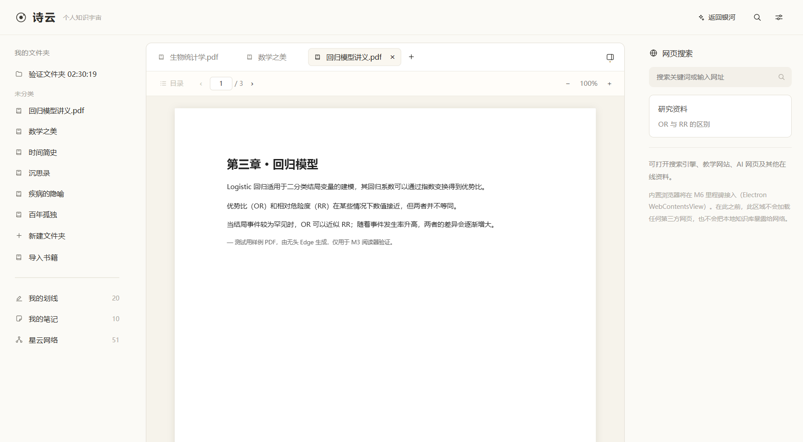
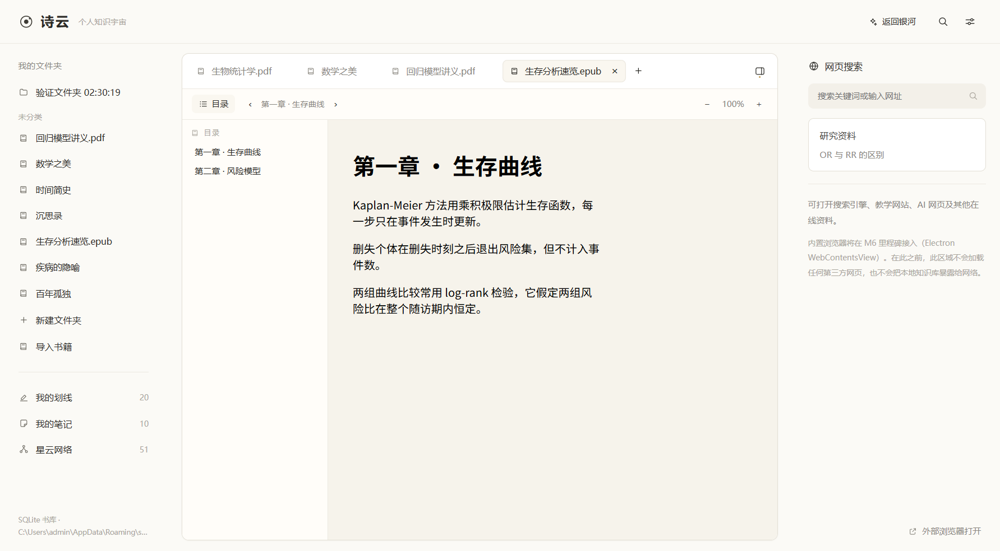

# 诗云 SHIYUN

> 在知识的宇宙中，寻找自己的星辰。

诗云是一个本地优先的个人知识管理桌面软件（Windows 优先）。它由两个共用同一份知识数据的空间组成：

- **银河大厅**：深色三维螺旋银河，承载书籍、划线、笔记、主题与知识关系。银河粒子只是氛围，与知识对象完全分离。
- **学习书房**：浅色三栏阅读工作台（文件树 / 多标签阅读与笔记 / 网页研究栏），用于真正读书、划线、写笔记与查资料。






> 第三张是 Electron 45 里的真实书库：目录来自 `%APPDATA%\shiyun\shiyun.db`；第四、五张是同一个数据库里的真实 PDF 与 EPUB 在阅读器里渲染的样子（PDF.js 画布 + 页码/缩放，EPUB.js 分页 + 目录 + 字号）。

## 当前进度

| 里程碑 | 内容 | 状态 |
| --- | --- | --- |
| M0 | 接管现有原型、基线验证、标签 `galaxy-baseline` | 完成 |
| M1 | Electron 外壳 + 银河/书房双空间导航 + 书房三栏骨架 | 完成（桌面窗口已实机验证） |
| M2 | SQLite 书库、真实文件夹树、导入 PDF/EPUB | 完成（桌面实机验证） |
| M3 | PDF.js / EPUB.js 阅读器（目录、翻页、缩放、阅读进度） | 完成（桌面实机验证） |
| M4 | 划线、笔记、多对多关联 | 下一步 |
| M5 | 真实知识库生成星图（GraphDataAdapter） | 未开始 |
| M6 | 右侧真实内嵌浏览器（WebContentsView） | 未开始 |
| M7 | 打磨、Windows 打包、自动更新 | 未开始 |

细节见 [DEVELOPMENT_PLAN.md](./DEVELOPMENT_PLAN.md)。任何"未实现"的界面元素都在 UI 中显式标注「开发中 / Mx 接入」，不使用静态假功能冒充已完成功能。

## 运行

需要 Node.js 20 或更高版本。

```bash
npm install
```

**浏览器模式**（无需 Electron 二进制，适合快速看界面）：

```bash
npm run dev:web
# http://localhost:5173          银河大厅
# http://localhost:5173/?space=workspace  直接打开学习书房
```

`?space=workspace` 只是开发与验收用的深链，正式入口是银河右上角的「进入书房」按钮和书房顶部的「返回银河」。

**桌面模式**（Electron）：

```bash
npm run dev
```

> `npm install` 会在 `postinstall` 阶段下载 Electron 二进制（约 150 MB）。如果网络无法访问 GitHub Releases，`node_modules/electron/dist` 会是空的，`npm run dev` 会报错而 `npm run dev:web` 仍可用。可设置镜像后重装：`ELECTRON_MIRROR=https://npmmirror.com/mirrors/electron/ npm install`。也可以用 `https://cdn.npmmirror.com/binaries/electron/<version>/` 直接下载 zip、校验 `SHASUMS256.txt` 后解压到 `node_modules/electron/dist`（详见 [AGENTS.md](./AGENTS.md) §7）。
>
> 若终端里有 `ELECTRON_RUN_AS_NODE=1`（某些 Electron 宿主的子进程会继承），启动前需要清掉，否则窗口不会出现。

**校验命令**：

```bash
npm run typecheck   # tsc -b
npm run lint        # oxlint
npm run test        # vitest run
npm run build       # 类型检查 + electron-vite 构建
npm run build:web   # 纯网页构建
```

## 已实现

### 银河大厅（M0 基线，保留原始实现）

- 稳定随机种子的三维螺旋银河：3–5 条旋臂、1–4 万批量粒子、星核、暗尘带、远景星场、受控 Bloom。
- 左键旋转、滚轮缩放、右键平移、阻尼、暂停、平滑聚焦、回到全景。
- 宇宙 / 知识 / 聚焦三种模式；节点悬停、单击、双击飞行、搜索、类型筛选、邻接高亮。
- 节点信息卡、关联对象、关系详情；新建演示笔记、连接两个节点成关系、删除关系但保留实体。
- 默认 / 高画质 / 低性能预设与实时视觉参数面板。
- 装饰层（`components/galaxy`）与知识层（`components/knowledge`）分离，共享相机坐标但不共享数据身份。

### 学习书房（M1）

- 与银河公用同一份 `KnowledgeGraphData`：左栏「我的划线 / 我的笔记 / 星云网络」计数、顶部全局搜索都读取真实图谱。
- 顶部导航：诗云标识、个人知识宇宙、全局搜索（回车或输入即搜，命中后跳回银河并聚焦该节点）、布局设置（重置栏宽、显示/隐藏研究栏）、「返回银河」。
- 左栏文件树：目录来自真实书库（见下节），支持展开/折叠、选中态、双击打开标签页。
- 中栏多标签阅读：可关闭标签、空状态、书页视图（章节、段落、米黄高亮块、添加划线 / 写笔记 / 关联节点工具行、笔记卡）、笔记页视图（M4 才可编辑，格式栏禁用并标注）。
- 右栏网页研究栏：真实可用的「外部浏览器打开」（Electron 下走 `window.shiyunDesktop.openExternal`，浏览器下走 `window.open`，只允许 http/https）；地址输入框在 M6 前禁用并注明原因。
- 三栏可拖拽（左 196–360px、右 264–440px）、右栏可隐藏，隐藏时中栏自动占满；全部 UI 状态持久化到 `localStorage` 键 `shiyun-workspace-ui-v1`。
- 深浅两个空间通过 `opacity / transform / visibility` 过渡共存，切到书房时银河暂停渲染。

### 阅读器（M3）

- PDF 用 `pdfjs-dist`：按中栏宽度「适合宽度 × 缩放」渲染当前页到 canvas（devicePixelRatio 已校正），支持翻页、页码输入、缩放 50%–300%、目录跳页（`getOutline` → `getPageIndex`）。
- EPUB 用 `epubjs`：CFI 定位、分页排版、目录（`loaded.navigation`）、左右方向键翻页、字号 70%–220% 缩放，`relocated` 事件回报当前章节。
- 书页由主进程的自定义协议 `shiyun-book://book/<id>/source.<ext>` 提供：渲染进程拿不到绝对路径，协议支持 `Range` 请求（206）供 PDF.js 分块读取，越权路径与目录穿越一律 404。
- 阅读进度写回 `reading_states`（PDF 存 `page`，EPUB 存 `cfi`，共用 `zoom`），去抖 700ms 保存并在组件卸载前 flush；重开同一本书停在原页码/原位置。
- 中文 PDF 需要 `cmaps`、部分 PDF 需要 `standard_fonts`：`npm run assets` 会把这两组文件从 `pdfjs-dist` 复制到 `public/pdfjs/`（已挂到 `predev` / `prebuild` 钩子上，`public/pdfjs` 不进版本库）。
- 书库里有书但没有源文件（原型迁移进来的书目）时，阅读区明确写「只保留了书目记录，源文件需要重新导入」，不排假版面；没有书签的 PDF 其「目录」按钮是禁用态——这是真实状态。

### 本地书库（M2）

- 主进程用 Node/Electron 内置 `node:sqlite`（Electron 45 的 Node 24 自带，无需原生模块编译，见 [ADR-010](./DECISIONS.md)）打开 `%APPDATA%\shiyun\shiyun.db`：WAL、`foreign_keys=ON`、每版本一个事务的迁移、迁移前备份、24 小时自动备份保留 14 份。
- IPC 全部经 `library:*` 通道，主进程校验来源（`file://` 或 dev server）与参数类型；渲染进程只通过 `window.shiyunDesktop.library.*` 访问。
- 左栏是真文件夹树：行内新建、右键重命名 / 移到未分类 / 删除、拖拽移动（含「未分类」投放区）、最多 3 层、禁止移到自身子树；删除文件夹时书籍落到「未分类」，删除书籍是软删（`deleted_at`），**笔记与划线从不级联删除**。
- 导入 PDF / EPUB：`dialog` 多选 → sha256 去重 → 复制到 `books/<bookId>/source.<ext>` → 写库；页数与封面留到 M3 真正解析文件。
- 首次启动把 `localStorage` 里的原型图谱一次性搬进 SQLite：书籍 → `books`、笔记 → `notes`、划线 → `highlights`（页码缺失时归入「原型划线（原书未知）」并记账）、关系 → `knowledge_links`、坐标 → `graph_layouts`；旧键改名为 `shiyun-prototype-knowledge-v1.migrated` 保留，不覆盖用户数据。
- 浏览器模式（`npm run dev:web`）没有 IPC，自动降级为内存演示书库，页脚会写明「演示书库 · 不会写入真实数据」。

### Electron 外壳（M1）

- `electron.vite.config.ts` 分别构建主进程、preload、渲染进程；preload 固定输出 CommonJS（`out/preload/index.js`），因为沙箱化 preload 不支持 ESM（ADR-009）。
- `contextIsolation: true`、`nodeIntegration: false`、`sandbox: true`、`webSecurity: true`。
- 仅暴露最小 API：`window.shiyunDesktop.getRuntimeInfo()` 与 `openExternal(url)`（限 http/https）。
- 拒绝 `window.open` 与外部导航，一律转交系统浏览器；IPC 校验消息来源。
- 生产（`file://`）加载时注入 CSP，开发模式不注入以免挡住 Vite HMR。已实机验证：`window.shiyunDesktop` 可用、IPC 返回 `{ platform: 'win32', electron: '45.4.1' }`。

## 项目结构

```text
electron/
├─ main/index.ts        # 窗口、IPC、导航与安全策略
├─ main/libraryService.ts # 书库生命周期（打开/迁移/备份）与业务操作
├─ main/libraryIpc.ts   # library:* 通道注册与参数校验
├─ main/db/             # 连接、迁移、备份、路径、书库读写、导入、原型迁移、阅读状态
├─ preload/index.ts     # contextBridge 暴露的最小桌面 API
scripts/
└─ copy-pdfjs-assets.mjs # 把 pdfjs 的 cmaps / standard_fonts 复制到 public/pdfjs
src/
├─ components/
│  ├─ galaxy/           # 银河装饰层：粒子、星核、背景、相机
│  ├─ knowledge/        # 知识层：节点与关系渲染
│  ├─ ui/               # 银河大厅的搜索、信息卡、调试面板、顶栏
│  └─ workspace/        # 学习书房：头部、文件树、阅读区（PDF/EPUB/占位）、研究栏、图标
├─ data/                # 知识仓储、书库桥接（桌面 IPC / 浏览器演示）、原型迁移
├─ types/               # 银河、知识、书房 UI、书库、阅读器、Electron API 类型
└─ utils/               # 确定性随机数
docs/screenshots/       # README 截图
```

## 已知限制

- 书库与阅读器都是真实的：目录、书籍、阅读进度（页码/CFI/缩放）都落盘并可恢复。但**划线还没法在真实书页上创建**——阅读区的「添加划线 / 写笔记 / 关联节点」仍是禁用态，等 M4。
- `highlights` / `notes` 里的数据目前来自原型迁移，还没有真实阅读产生的划线。
- PDF 每次只渲染当前一页（没有连续滚动），大文档靠翻页；EPUB 的主题、双栏、滚动模式未提供，`scroll_ratio` 字段先占位。
- 右侧「网页搜索」不是内嵌浏览器；输入框禁用到 M6 接入 `WebContentsView` 为止。
- 回收站只有数据层接口（`restoreBook`），还没有界面；书库位置固定为 `%APPDATA%\shiyun`，未做自定义目录设置。
- 桌面窗口已实机验证，但只验证了 `out/` 的构建产物；Windows 安装包与自动更新未做（M7）。
- 中文正文字体当前来自 Google Fonts CDN，离线时回退到系统字体；M7 打包前自托管并收紧 CSP。
- 知识布局仍是确定性的银河簇布局，不运行全局力导向模拟。

## 文档

| 文档 | 内容 |
| --- | --- |
| [ARCHITECTURE.md](./ARCHITECTURE.md) | 进程、分层、数据流、组件职责 |
| [DATABASE_SCHEMA.md](./DATABASE_SCHEMA.md) | SQLite 表结构、ID 策略、迁移与备份（M2 已实现 `001_init`） |
| [DEVELOPMENT_PLAN.md](./DEVELOPMENT_PLAN.md) | M0–M7 目标、验收与当前进度 |
| [DECISIONS.md](./DECISIONS.md) | 技术选型与取舍记录 |
| [THIRD_PARTY_LICENSES.md](./THIRD_PARTY_LICENSES.md) | 依赖许可证与参考项目 |
| [AGENTS.md](./AGENTS.md) | 给后续开发者 / AI 代理的工作约定 |

## 开源与参考

项目没有复制参考仓库的代码；视觉数学、粒子分层与交互范式来自公开项目的研究。依赖许可证、参考来源与声明义务见 [THIRD_PARTY_LICENSES.md](./THIRD_PARTY_LICENSES.md)。
